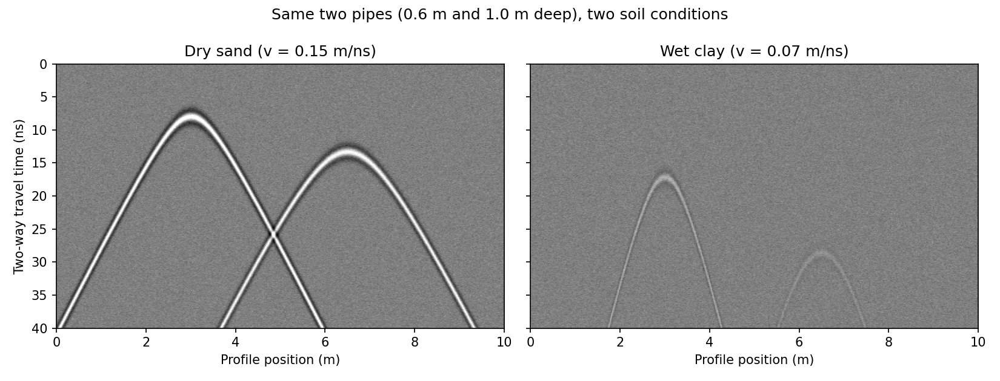

# GPR Data Quality – Independent Learning Exercise

An independent learning exercise prepared in November 2026 to develop a practical understanding of Ground Penetrating Radar (GPR) data processing and metadata documentation, in preparation for an EngD application focused on utility mapping.

## What I did

- Processed a real GSSI example profile using Python and GPRPy.
- Applied dewow, background removal and time-power gain.
- Converted travel time to estimated depth using an assumed wave velocity of 0.1 m/ns.
- Created a simplified illustrative simulation comparing two buried pipes in different assumed soil conditions.
- Read the file header through GPRPy and directly from the raw file, which showed two fields that GPRPy does not display (antenna name and creation date).
- Developed a 17-field metadata checklist for documenting GPR surveys, with the source and status of each field.

## Files

| File | What it is |
|---|---|
| `Hassanpour_Shiva_GPR_Learning_Note.pdf` | One-page summary of the exercise, observations and limitations |
| `step1_real_profile.py` | Processes the example profile (dewow, background removal, gain, depth conversion) and saves `fig1`–`fig3` |
| `step2_simulated_pipes.py` | Simplified, illustrative simulation of two pipes in two assumed soils (`fig4`) |
| `step3_header.py` | Prints the file header as GPRPy reads it |
| `step4_raw_header.py` | Reads the antenna name and creation date directly from the raw .DZT header |
| `processing_history.py` | Processing steps and parameters, saved automatically by GPRPy |
| `GPR_metadata_form.xlsx` | 17 proposed metadata fields, filled in for the example file: 8 missing (including all four ground-condition fields), 2 found only in the raw header |
| `fig1_raw.pdf`, `fig2_processed.pdf`, `fig3_depth.pdf` | Raw, processed and depth-converted profile |
| `fig4_simulated_pipes.png` | Simulated radargrams |

## How to run

1. Install Python 3 with NumPy and Matplotlib, and install GPRPy (https://github.com/NSGeophysics/GPRPy).
2. Put the scripts in the folder that contains the GPRPy folder, so that `gprpy/exampledata/GSSI/FILE____032.DZT` can be found.
3. Run `python step1_real_profile.py`, then steps 2–4 in the same way.

`processing_history.py` was generated on Windows and contains the file path on that computer; change the path before running it elsewhere.

## Limitations

This is an educational exercise, not a validated GPR detection or electromagnetic modelling study. The simulated soil conditions use assumed parameters, and the depth conversion has not been field-calibrated.

## Tools

Python, NumPy, Matplotlib and GPRPy.

## Data source

GSSI example dataset distributed with the open-source GPRPy software.

## Acknowledgements

The example dataset and processing functions come from GPRPy (MIT License):
Plattner, A. M. (2020). GPRPy: Open-source ground-penetrating radar processing and visualization software. *The Leading Edge*, 39(5), 332–337. https://doi.org/10.1190/tle39050332.1

The Python scripts were prepared with the help of an AI assistant. I ran, modified and documented them, built the metadata checklist and wrote the learning note.

## Author

Shiva Hassanpour  
MSc Urban Planning and Policy Design, Politecnico di Milano
